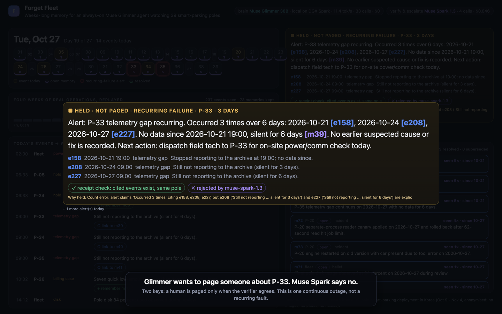

# Forget Fleet

**Weeks-long memory for an always-on Muse Glimmer agent.**

> Monitoring tells you what's broken now. Memory tells you it's the third time.

We run a 39-pole smart-parking deployment in Korea. Every pole has cameras, a plate reader and an engine. It runs 24/7, and it fails slowly: a reboot here, a hold there, a rollout that only half lands. The signal is spread across weeks, but an agent's context only covers hours.

Forget Fleet is an always-on operations agent built on **Muse Glimmer 30B**, running locally on one DGX Spark. Every day it reads the fleet's events and decides what is worth carrying for weeks. When a failure keeps coming back, it tells you, and it cites the exact events behind every claim.

**Demo video:** https://youtu.be/DiNXC4gc3dM (2:47)



## What it does

| Step | Model | What happens |
|---|---|---|
| **WRITE** | Muse Glimmer 30B, local | Reads the day's events and decides for each: remember a new problem, link it to an earlier memory, resolve it, supersede an old belief, or ignore routine noise. Every operation must cite real event ids. Ops without valid ids are rejected. |
| **RECALL → ALERT** | Muse Glimmer 30B, local | When an open memory collects device-health failures on 3 or more days, Glimmer writes an operator alert using only that memory and its events. |
| **CHECK** | code | Every event the alert cites must exist and belong to the same pole. If there's no receipt, there's no alert. |
| **VERIFY / ESCALATE** | Muse Spark 1.3, Meta Model API | Independently verifies each alert's counts, dates and causes against the raw events. Diagnoses days when five or more poles fail the same way (a shared cause, such as a rollout, versus independent faults). |

The memory store is an append-only ledger. Memories are linked, resolved or superseded, never silently rewritten, and each keeps the ids of the events that support it.

## Results (recorded live run)

**The always-on run (`runs/replay_v3.json`).** 302 events over 27 days. Muse Glimmer made every memory decision locally: 54 calls at about 11.6 tokens/s, about $0. Muse Spark was called 9 times for escalation and 8 times for verification, for about $0.20 in total.

- **Memory:** Glimmer kept 110 memories (105 open, 3 resolved, 2 superseded). It linked 27 repeats to earlier memories instead of filing new notes, and it ignored all 27 daily routine digests. Seven device-health events it didn't cover were caught by the code safety net.
- **Escalation (Oct 21):** five poles went quiet on the same evening. Muse Spark judged the three simultaneous 19:00 silences to be one shared cause rather than three independent faults, and told the operator to check archive ingest and that evening's power and removal work. The removal work was the cause: three bays had been taken out for construction.
- **Alerts and two-key paging:** Glimmer raised 8 recurring-failure alerts, and every one passed the receipt check. Muse Spark verified 1 and held 7:
  - **Paged (P-19):** three outages in 19 days (Oct 15, Oct 17, Nov 3) with a power/network suspicion. The verifier found every claim supported.
  - **Held, 6 alerts (P-33, P-34, P-35):** Glimmer counted each "still not reporting" check as a new failure. The verifier saw one continuous outage, the bays that had been removed. Without the second key, three bays under construction would have paged a technician six times.
  - **Held (P-23):** Glimmer correctly counted three reboots in 19 days (Oct 16, Oct 21, Nov 4) but blamed outdated plate logic. The verifier rejected the causal claim, so a human reviews it with the receipts attached.
- **What this shows honestly:** a 30B local model is fast and private enough to watch a fleet all day, and it counts well, but it overreaches on causes and continuity. That is why the design pages a human only when two models agree.

**Operator questions (`runs/eval_qa.json`).** 11 questions that need weeks of history, all answered by the same local Muse Glimmer. Muse Spark graded each answer 0-2 against the full raw log, without knowing which arm wrote it.

| Arm (same model) | Score | Avg prompt tokens |
|---|---|---|
| Full raw log pasted into context | **16 / 22** | 10,175 |
| Forget recall (pick from the memory index, then expand receipts) | 9 / 22 | 6,565 |
| Forget memory, keyword retrieval | 6 / 22 | 1,088 |
| No history | 0 / 22 | 114 |

The honest read: four weeks of this fleet (302 events) still fits in Glimmer's context, and reading the whole log beats our memory recall. Glimmer's notes are too fragmented (110 memories for 302 events), and recall misses details. At this horizon, memory earns its place in the always-on loop: deciding, alerting and escalating every day without rereading everything. It should matter more over horizons where the log no longer fits, but we have not measured that yet. Better consolidation and recall are our next step.


These come from one recorded run on our own data. They are not a benchmark. Model outputs vary between runs.

## Data and privacy

- **Ops logbook:** 255 events written down by our team from Oct 9 to Nov 4: reboots, holds, rollouts, disk alarms, power and network faults. Muse Spark converted them into structured events.
- **Archive telemetry:** 36,692 hourly archive records (file present and size only) from all poles, used to derive reporting gaps.
- **Never used:** camera images, plate numbers and people's names. Site and pole names are replaced (`P-01`…`P-39`). The anonymised stream is in `data/stream.json`.

## Run it

Requirements: Python 3.9+ with no extra packages, a local Muse Glimmer server, and a Meta Model API key for the Muse Spark verifier (optional).

```bash
# 1. Serve Muse Glimmer locally (we use llama.cpp on a DGX Spark)
huggingface-cli download meta-models/Muse-Glimmer-30B-GGUF Muse-Glimmer-30B-KQuant-17GB-Q4_K_M.gguf --local-dir .
llama-server -m Muse-Glimmer-30B-KQuant-17GB-Q4_K_M.gguf --port 30111 -ngl 99 -c 32768 --parallel 1 -fa on -ctk q8_0 -ctv q8_0 --jinja

# 2. Replay four weeks through the always-on agent
cp .env.example .env                  # optional: MODEL_API_KEY for the Muse Spark verifier
python3 run_replay.py                 # -> runs/fleet_replay.json
python3 tools/verify_alerts.py        # second key: Muse Spark verifies every alert
python3 eval_qa.py && python3 tools/eval_recall2.py   # operator questions: memory vs full log vs none

# 3. Look at it
python3 tools/build_viewer.py && python3 -m http.server 8000   # open http://localhost:8000/web/
```

## Code map

- `fleetmem/agent.py`: the always-on agent: WRITE, alert from memory, receipt check, Muse Spark verify and escalation.
- `fleetmem/fleet_ledger.py`: append-only fleet memory (remember, link, resolve, supersede).
- `fleetmem/client.py`: one stdlib client for both local Muse Glimmer (llama.cpp, OpenAI-compatible) and the Meta Model API.
- `run_replay.py`, `eval_qa.py`, `tools/eval_recall2.py`, `tools/grade_eval.py`: four-week replay and the question evaluation.
- `tools/verify_alerts.py`: the second key. Muse Spark verifies each alert against its receipt and cited memories (run as a separate pass, like an async queue).
- `tools/extract_logbook.py`, `tools/build_stream.py`: how the anonymised event stream was built.
- `web/index.html`: the fleet viewer used in the video.

## What was built during the hackathon

Everything in this repository was written during the hackathon, on Nov 4-5, 2026: the agent, the ledger, the clients, the stream builder, the replay, the evaluation and the viewer. The Muse Glimmer server setup on our DGX Spark was also new.

**Pre-existing, not part of this submission:**
- The smart-parking deployment itself, and the ops logbook our team kept while running it.
- Multi-turn's hosted memory product, [Forget](https://forget.sh). Its ideas (receipts, supersede rather than overwrite) shaped this design, but this repo neither contains nor calls Forget's engine.

## License

MIT
